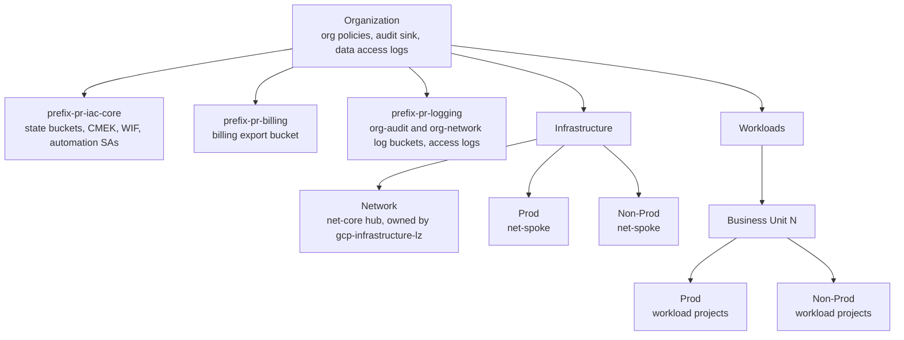
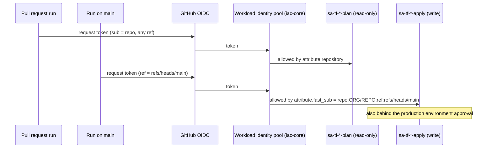

# Architecture

## Resource hierarchy this repository builds

Core projects sit directly under the organization on purpose: they must survive any folder reorganization and must not inherit folder-level policy exceptions.

## Who can run Terraform

- A pull request can only ever become the **plan** identity. It reads state, never writes it (`-lock=false`, `objectViewer`).
- Only the `main` branch can become the **apply** identity, and only after a human approves the `production` environment.
- The provider rejects tokens from any other GitHub owner. It accepts the pipeline repositories, every repository named in a stage 3 YAML file, and `additional_repositories` (the `cicd-runners` repository). Only a pipeline repository can impersonate a bootstrap or landing-zone service account. A workload repository can impersonate only the deployer and planner of its own project.

## State

| Bucket | Holds | Written by |
|---|---|---|
| `<prefix>-pr-tfstate-bootstrap` | state of this repository, prefix `bootstrap/<stage>` | `sa-tf-bootstrap-apply` |
| `<prefix>-pr-tfstate-lz` | state of `gcp-infrastructure-lz` | `sa-tf-lz-apply` |
| `<prefix>-pr-<env>-<bu>-tfstate` | state of one workload repository, encrypted with that project's key | that project's deployer |

Buckets are versioned, CMEK-encrypted (state buckets in `iac-core`), uniform-access, public access prevented, access-logged, and never deletable by the plan identities.

## Cross-repository contract

`gcp-infrastructure-lz` reads two outputs of this repository through `terraform_remote_state`: `1-org.folder_ids` and `3-workload-projects.projects`. Treat those output names as an API. Changing them is a breaking change and needs a coordinated PR in the other repository.
