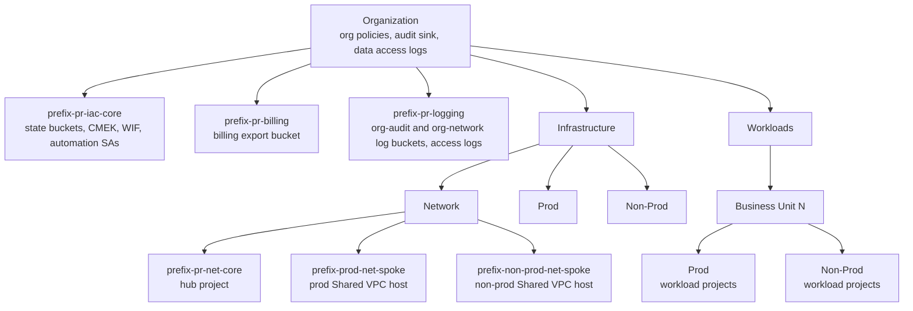
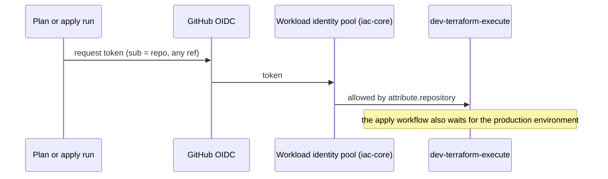

# Architecture

## Resource hierarchy this repository builds

Core projects sit directly under the organization on purpose: they must survive any folder reorganization and must not inherit folder-level policy exceptions.

## Who can run Terraform

- `dev-terraform-execute` in the iac-core project runs Terraform for this repository, `gcp-infrastructure-lz` and every workload project. `sa-billing-reader` and `sa-logging-reader` cannot run Terraform.
- Any ref of a bound repository can impersonate that account, so a pull-request plan uses an account that can write. Plans still run with `-lock=false`.
- The apply workflow runs only from `main`, after a human approves the `production` environment.
- The provider rejects tokens from any other GitHub owner. It accepts the pipeline repositories, every repository named in a `4-workload-projects` YAML file, and `additional_repositories` (the `cicd-runners` repository). `cicd-runners` may mint a token and does not get `dev-terraform-execute`.

## State

| Bucket | Holds | Written by |
|---|---|---|
| `<prefix>-pr-tfstate-bootstrap` | state of this repository, prefix `bootstrap/<stage>` | `dev-terraform-execute` |
| `<prefix>-pr-tfstate-lz` | state of `gcp-infrastructure-lz` | `dev-terraform-execute` |
| `<project-id>-tfstate` | state of one workload repository, encrypted with that project's key | `dev-terraform-execute` |

Buckets are versioned, CMEK-encrypted (state buckets in `iac-core`), uniform-access, public access prevented and access-logged. `dev-terraform-execute` has `objectAdmin` on each of them.

## Cross-repository contract

`gcp-infrastructure-lz` reads output `projects` from state prefix `bootstrap/3-workload-projects` (directory `4-workload-projects`) and attaches those projects to the Shared VPC hosts. It does not create the hub or the host projects. Those ids are fixed in `gcp-terraform-module/modules/naming` and the projects are created by `2-network-projects` under `infrastructure/network`. `1-org.folder_ids` and `2-network-projects.projects` stay stable outputs. Changing any of those names, or a network project id, is a breaking change and needs a coordinated PR in the landing-zone repository. The cicd state prefix stays `bootstrap/2-cicd-identity`.
