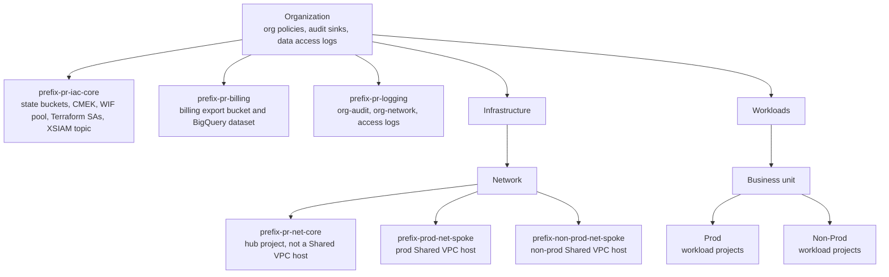
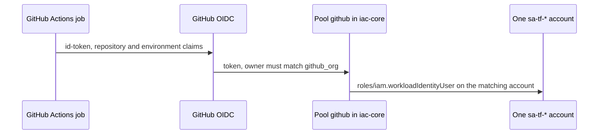

# Architecture

## Resource hierarchy this repository builds

Core projects sit directly under the organization. They stay outside the folder tree so a folder move does not take the state buckets or the automation identities with it.

`1-org` creates two top-level folders. `Infrastructure` has one child, `Network`, and all three network projects live there. `Workloads` has one folder per business unit, and each of those has `Prod` and `Non-Prod`. Workload projects from `4-workload-projects` are created in `workloads/<business-unit>/<environment>`.

Stage `2-network-projects` creates the three network projects and stops. VPCs, firewall policy, Cloud NAT, DNS, and Network Connectivity Center are created later by `gcp-infrastructure-lz` inside those projects.

## Who can run Terraform

Stage `0-core-projects` creates one Workload Identity pool, `github`, and one provider, `github-actions`, in `prefix-pr-iac-core`. The provider accepts a token only when `repository_owner` equals `github_org`. Each service account then has its own binding.

| Service account | Repository | Impersonation |
|---|---|---|
| `sa-tf-bootstrap` | `gcp-foundation-bootstrap` | Any job in that repository |
| `sa-tf-infra-prod` | `gcp-infrastructure-lz` | GitHub environment `production` |
| `sa-tf-infra-nonprod` | `gcp-infrastructure-lz` | GitHub environment `nonprod` |
| `sa-tf-workload-prod` | `gcp-workload` | GitHub environment `production` |
| `sa-tf-workload-nonprod` | `gcp-workload` | GitHub environment `nonprod` |

Repository names come from `bootstrap_repository`, `infra_lz_repository`, and `workload_repository`. All five accounts live in the iac-core project. `sa-billing-reader` and `sa-logging-reader` are read-only and are not pipeline identities. `sa-prisma-cloud` is created only when `enable_prisma_cloud` is true.

`sa-tf-bootstrap` has no environment condition on its binding. The apply workflow in this repository still runs only from `main`, after the `production` environment is approved, and it authenticates as `TF_SA_BOOTSTRAP`. Plan and drift jobs in this repository declare the `nonprod` environment and use the same account.

`sa-tf-infra-*` receive network roles on the hub and the matching spoke project in stage `2-network-projects`. `sa-tf-workload-*` receive deployer roles on workload projects of the matching environment in stage `4-workload-projects`. Each environment folder under a business unit grants `roles/compute.xpnAdmin` to the matching infra account so that account can attach workload projects to its Shared VPC host.

## State

| Bucket | Prefixes | Who can write |
|---|---|---|
| `<prefix>-pr-tfstate-bootstrap` | `bootstrap/0-core-projects`, `bootstrap/1-org`, `bootstrap/2-network-projects`, `bootstrap/3-workload-projects` (directory `4-workload-projects`) | `sa-tf-bootstrap` has `objectAdmin`. Both infra accounts have `objectViewer` so `gcp-infrastructure-lz` can read workload outputs. |
| `<prefix>-pr-tfstate-lz` | `lz/1-network-hub`, `lz/2-network-spokes`, written by `gcp-infrastructure-lz` | `sa-tf-infra-prod` and `sa-tf-infra-nonprod` have `objectAdmin` |
| `<project-id>-tfstate` | one workload repository | The workload account for that project's environment has `objectAdmin` |

The two platform buckets are in iac-core. They are versioned, encrypted with the `tfstate` key in that project, uniform-access, public access prevented, and access-logged to `<prefix>-pr-access-logs` in the logging project. Each workload state bucket is in its own project and uses that project's `workload` keyring.

## Cross-repository contract

`gcp-infrastructure-lz` builds networks in projects this repository already created. Hub and spoke project ids come from `gcp-terraform-module/modules/naming`, using the same `prefix`. Stage `2-network-projects` reads `folder_ids["infrastructure/network"]` from state prefix `bootstrap/1-org`.

The spoke stage reads output `projects` from state prefix `bootstrap/3-workload-projects` and attaches each workload project to the Shared VPC host for its environment. It grants `roles/compute.networkUser` on the spoke subnets to `projects[*].terraform_executor_email`, which is the workload service account for that environment.

Stable outputs for that contract:

| Output | Stage | Used for |
|---|---|---|
| `wif_provider` | `0-core-projects` | GitHub variable `WIF_PROVIDER` in each pipeline repository |
| `automation_service_accounts` | `0-core-projects` | `TF_SA_BOOTSTRAP` here, `TF_SA` in the other two repositories |
| `state_buckets` | `0-core-projects` | `TF_STATE_BUCKET` (`bootstrap` here, `lz` in `gcp-infrastructure-lz`) |
| `sa_emails`, `folder_ids` | `1-org` | Stages 2 and 4, through remote state |
| `projects` | `2-network-projects` | Network project ids and whether each is a Shared VPC host |
| `projects` | `4-workload-projects` | Workload project ids, state buckets, and deployer account emails |

Changing `folder_ids` keys, the `projects` output shape, the state prefixes above, or a name in `modules/naming` needs a coordinated change in `gcp-infrastructure-lz`.
